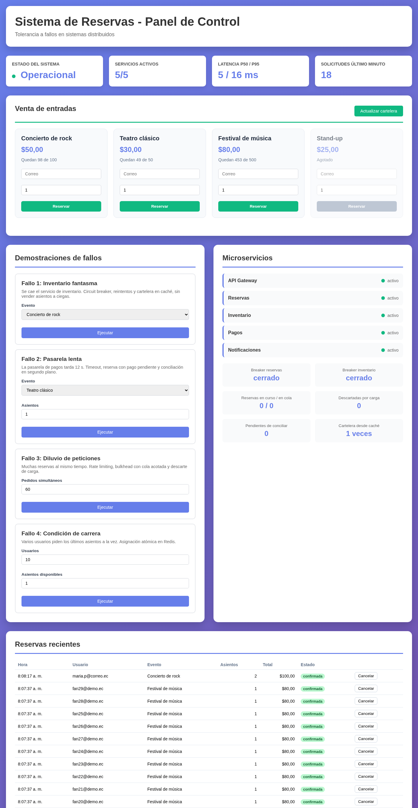
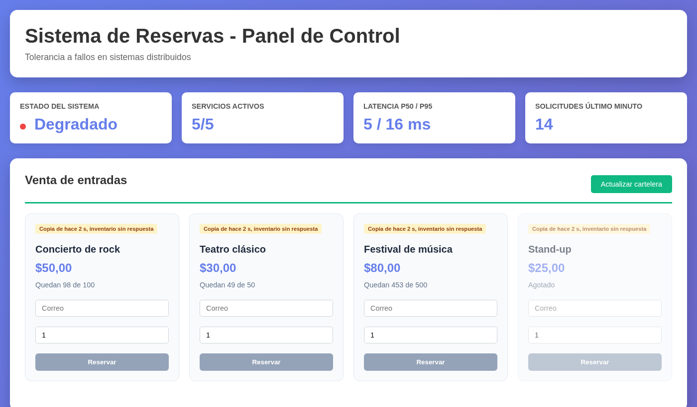

# reservas-tolerancia-fallos

[](https://github.com/Whiteherobot/reservas-tolerancia-fallos/actions/workflows/ci.yml)

Venta de entradas con microservicios en Node.js que siguen funcionando cuando
algo falla: el inventario se cae, la pasarela de pagos se vuelve lenta, llegan
demasiadas peticiones o varios usuarios compiten por el último asiento. Proyecto
de Sistemas Distribuidos (enero de 2026), hecho en pareja.



## Arquitectura

```
navegador ──> api-gateway :3000 ──> reservas ──> inventario ──> Redis
              rate limiting          │  conciliador  (asientos)
              bulkhead               ├──> pagos (pasarela simulada)
              cartelera en caché     └──> notificaciones
```

| Servicio | Qué hace |
|---|---|
| `api-gateway` | Sirve el panel, limita peticiones por cliente, reparte la carga con un bulkhead, guarda la última cartelera y corre las demostraciones. |
| `reservas` | Orquesta la reserva: asigna asientos, cobra, confirma o compensa. Guarda las reservas en Redis y concilia lo que quedó a medias. |
| `inventario` | Asientos por evento en Redis. Asignar y liberar son atómicos e idempotentes (scripts Lua). |
| `pagos` | Pasarela de pagos simulada: un pago por reserva, rechazo del 5 % y latencia configurable. |
| `notificaciones` | Correos simulados. Si falla, la reserva sigue valiendo y el correo se reintenta. |

Una reserva termina `confirmada` (201), `pago-pendiente` (202), `rechazada`
(409 sin asientos, 402 pago rechazado, 503 inventario caído) o `cancelada`.

## Los cuatro fallos

| Fallo | Patrones |
|---|---|
| Inventario fantasma | Circuit breaker, reintentos con espera exponencial, cartelera en caché solo de lectura |
| Pasarela lenta | Timeout, estado pendiente (202), conciliación en segundo plano, pago idempotente |
| Diluvio de peticiones | Rate limiting, bulkhead con cola acotada, load shedding |
| Condición de carrera | Asignación atómica en Redis |

El detalle de cada uno, y qué estaba mal en la versión original, está en
[docs/fallos.md](docs/fallos.md).



## Cómo correrlo

```bash
docker compose up -d --build     # panel en http://localhost:3000
node scripts/demo.js pasarela-lenta
docker compose down -v
```

Con `PUERTO=8080 docker compose up -d` cambia el puerto del panel. Solo el
gateway queda expuesto; los demás servicios se hablan por la red interna.

Sin Docker hace falta un Redis local (`REDIS_URL`, por defecto
`redis://localhost:6379`):

```bash
npm ci
npm start                        # levanta los cinco servicios
```

### API

| Método | Ruta | |
|---|---|---|
| GET | `/api/inventario` | Cartelera. Si viene de la copia, trae el encabezado `X-Desde-Cache` con la edad en segundos. |
| POST | `/api/reservas` | `{ "eventoId": "evento-1", "asientos": 2, "usuario": "ana@correo.ec" }`. Con `Idempotency-Key` se puede reintentar sin duplicar. |
| GET | `/api/reservas` · `/api/reservas/:id` | Últimas 50 reservas o una. |
| DELETE | `/api/reservas/:id` | Cancela: reembolsa el pago y devuelve los asientos. |
| GET | `/api/estado` | Servicios, circuit breakers, bulkhead y métricas medidas (latencia p50/p95, solicitudes del último minuto). |
| POST | `/demo/:nombre` | `inventario-fantasma`, `pasarela-lenta`, `diluvio-peticiones`, `condicion-carrera`. |

## Pruebas

```bash
docker run -d --rm -p 6379:6379 redis:7-alpine
REDIS_URL=redis://localhost:6379/15 npm test
```

33 pruebas con `node:test`: la parte de resiliencia por separado (reintentos solo
de lo idempotente, breaker, timeout, bulkhead) y cada servicio con un Redis real
(50 pedidos simultáneos por 5 asientos, compensación al rechazar el pago, pago
pendiente que confirma el conciliador, anulación al vencer el plazo, reintento
de asientos por devolver, idempotencia, rate limiting, descarte y caché).
`scripts/probar.sh` corre las cuatro demostraciones contra el `docker compose`
levantado; la CI hace las dos cosas.

## De dónde sale

En 2026 se revisó el proyecto (antes `SistemadeReservas`) y se corrigió la
lógica de fondo, no solo lo que se veía en el panel: sobreventa cuando Redis
fallaba, pagos y reservas que se reintentaban sin idempotencia (cobros dobles),
un lock que vencía durante el cobro, latencia simulada que no se activaba,
métricas inventadas y demos que no pasaban por los patrones que decían mostrar.
Se reemplazaron las guías largas y el script de PowerShell por este README,
`docs/fallos.md` y pruebas automáticas.

## Autores

- Michael Lata ([@Whiteherobot](https://github.com/Whiteherobot))
- Michael Franco ([@michfranko](https://github.com/michfranko))

Licencia MIT.
